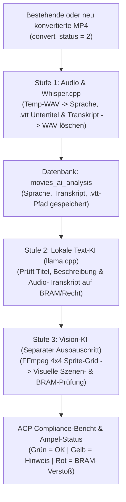

# 🤖 Lokale KI-Compliance- & Untertitel-Pipeline (Konzept & Architektur)

> **Kontext-Referenzen:** Dieses Dokument ergänzt die allgemeinen Projektvorgaben aus `@master.md`, die Dokumentations-Richtlinien aus `@documentation-standards.md` sowie den Video-Lebenszyklus aus `@video-management.md`.
> **Status:** Lebendes Architektur- & Planungsdokument (wird im Projektverlauf fortlaufend verfeinert und erweitert).

Dieses Dokument beschreibt das Gesamtkonzept sowie die schrittweise Umsetzung (Best Practice) für eine lokal auf dem EroCloud-Server betriebene KI-Pipeline zur:
1. **Audio-Auswertung & Untertitel-Generierung** (Spracherkennung, `.vtt`-Untertitel, Volltext-Transkription des gesprochenen Wortes im Video).
2. **Text-Compliance-Prüfung (Visa/Mastercard BRAM & Rechtliches)** für Creator-Eingaben (Titel, Beschreibung, SEO) sowie das gesprochene Audio-Transkript.
3. **Visuellen Video-Inhaltsanalyse (Vision-KI)** über intelligente Frame-Collagen (Sprite-Grids) in einer nachgelagerten Ausbaustufe.

---

## 1. 🖥️ Server-Hardware & Technische Rahmenbedingungen

Die Architektur ist exakt auf die physische Hardware des EroCloud-Hauptservers abgestimmt:

* **Server-Modell:** Dell Inc. PowerEdge R720 (`t199.nlserver.net`)
* **Betriebssystem:** Debian GNU/Linux 10 (Buster)
* **Prozessor (CPU):** 2x Intel(R) Xeon(R) CPU E5-2690 v2 @ 3.00GHz (**20 Kerne / 40 Threads**, 25 MB Cache, Ivy-Bridge-EP Architektur)
* **Grafikkarte (GPU):** Keine dedizierte GPU verbaut (reine CPU-Inferenz)
* **Arbeitsspeicher (RAM):** 62,86 GiB DDR3 ECC (Grundauslastung ~5 %, bis zu **32 GB RAM** für lokale KI-Prozesse verfügbar)
* **Speicherplatz (`/var/www/web1/cloud_storage`):** 5,20 TiB (aktuell ~87 % belegt – daher **strikte Vermeidung dauerhafter großer Zusatzdateien** wie unkomprimierter WAV-Audiodateien!).

### Kritische Hardware-Besonderheiten (Best Practices für Xeon E5-2690 v2):
1. **CPU-Befehlssatz (AVX1 + F16C, kein AVX2):**
   * Da die Xeon E5-2690 v2 Generation noch kein `AVX2` unterstützt, dürfen keine vorkompilierten Standard-Binaries (die `AVX2` voraussetzen) verwendet werden.
   * **Lösung:** Einsatz von **`whisper.cpp`** (für Audio/Untertitel) und **`llama.cpp`** (für Text- & Vision-LLMs), direkt auf dem Server aus dem C/C++-Quellcode mit `-DGGML_NATIVE=ON` kompiliert. Das garantiert maximale Geschwindigkeit auf allen 20 Kernen ohne Python-/PyTorch-Abhängigkeitsprobleme unter Debian 10.
2. **Kein „Safety-Refusal“ bei Adult-Content:**
   * Standard-Sprachmodelle blockieren die Auswertung expliziter Erotik-Texte. Daher werden ausschließlich **Uncensored / Abliterated** Modell-Varianten (im GGUF-Format, Quantisierung `Q4_K_M` oder `Q5_K_M`) eingesetzt, die neutral und präzise anhand unseres BRAM-Regelwerks prüfen.
3. **Ressourcenschonung gegenüber Live-Betrieb & Video-Konvertierung:**
   * KI-Prozesse laufen immer mit reduzierter Prozesspriorität (`nice -n 15`) und begrenzter Thread-Anzahl (z. B. 12–16 von 40 Threads).
   * Wenn `cronjobs/convert_movie.php` aktiv Videos konvertiert (`convert_status = '1'`), drosselt oder pausiert der Hintergrund-KI-Cronjob automatisch.

---

## 2. 🔄 Architektur-Entscheidung: Entkopplung von der Video-Konvertierung

### Warum die Extraktion NICHT fest in `convert_movie.php` eingebaut werden muss (und sollte):
* Auf dem Server liegen bereits **über 5.500 fertig konvertierte Bestandsvideos** (`convert_status = '2'`), die nachträglich analysiert werden müssen.
* Bei jedem fertig konvertierten Film (sowohl Altbestand als auch Neu-Uploads nach Abschluss der Konvertierung) liegt die fertige **Desktop-MP4 (`{id}_{file_id}.mp4`)** bereits im Film-Ordner vor.
* Aus einer bestehenden MP4-Datei extrahiert FFmpeg die für Whisper benötigte `16kHz Mono WAV`-Audiospur (`-vn -acodec pcm_s16le -ar 16000 -ac 1`) in **nur 1 bis 3 Sekunden**!
* **Speicherplatz-Vorteil:** Würde man während der Konvertierung für 5.500 Filme dauerhaft WAV-Dateien aufheben, würde das über **150 GB Speicherplatz** verschwenden. Stattdessen erzeugt der Analyse-Prozess die `.wav`-Datei *just-in-time* aus der `.mp4`, übergibt sie direkt an `whisper.cpp`, speichert die winzige `.vtt`-Untertiteldatei (wenige Kilobyte) sowie das Text-Transkript in der Datenbank und **löscht die temporäre `.wav`-Datei sofort wieder (`unlink`)**.
* **Einheitlicher Workflow:** Dadurch funktioniert ein und derselbe Prozess zu 100 % identisch für das **Testen an einem einzelnen Video**, für die **Nachbearbeitung aller >5.500 Bestandsvideos** und für **alle zukünftig hochgeladenen Videos** (sobald `convert_status = '2'` erreicht ist).

---

## 3. 🧱 Die 4 Ausbaustufen (Phasen-Planung)

Um volles Vertrauen in die Ergebnisse, die Geschwindigkeit und die Erkennungsqualität auf dem Live-Server zu gewinnen, wird das System strikt modular von Phase 1 bis Phase 4 aufgebaut:

### Phase 1: Einzel-Video-Testlabor im ACP (Proof of Concept & Feinjustierung)
Bevor irgendein Cronjob über tausende Filme läuft, bauen wir im Admin Control Panel (ACP) unter einer eigenen Seite (z. B. `/KI-Analyse` -> `acp/includes/ai_compliance_lab.php`) ein **interaktives Test-Cockpit**:
1. **Gezielte Video-Auswahl:**
   * Eingabe einer beliebigen `movie_id` (oder Auswahl aus einer Liste hochgeladener Creator-Videos).
   * Anzeige der aktuellen Film-Metadaten (Titel, Beschreibung, Kategorien, Laufzeit, Dateipfad der `.mp4`, Status).
2. **Manueller Test-Button für Modul A (Audio -> Untertitel & Transkript):**
   * Klick auf **„1. Audio & Untertitel jetzt extrahieren (Whisper)“**:
   * Extrahiert temporär die Audiospur der gewählten MP4, führt `whisper.cpp` aus und löscht die temporäre WAV-Datei.
   * **Sofort-Anzeige im ACP:**
     * Erkannte Sprache (z. B. `Deutsch (98.4 %)` oder `Kein gesprochener Text erkannt`).
     * Benötigte Server-Rechenzeit (z. B. `14,2 Sek. bei 12 Threads`).
     * Vorschau der erzeugten `.vtt`-Untertiteldatei + vollständiges Text-Transkript mit Zeitstempeln (`[00:12 - 00:18] ...`).
     * Speicherung in der Datenbank (`movies_ai_analysis`).
3. **Manueller Test-Button für Modul B (Text- & Transkript-Compliance via lokaler KI):**
   * Klick auf **„2. Texte & Transkript mit KI auf BRAM prüfen“**:
   * Sendet Filmtitel, Filmbeschreibung und das aus Modul A gewonnene Audio-Transkript an das lokale Sprachmodell (`llama.cpp`).
   * Über ein direkt im ACP anpassbares **Regel-/Prompt-Feld** können wir unsere verbotenen Begriffe und BRAM-Kriterien live testen und verfeinern.
   * **Sofort-Anzeige im ACP:**
     * Compliance-Ampel (**Grün / Gelb / Rot**) & Risiko-Score (`0–100`).
     * Konkrete Begründung der KI, welche Textstelle im Titel, in der Beschreibung oder bei welcher Sekunde im gesprochenen Video-Text verdächtig ist.

### Phase 2: Gesteuerter Batch-Lauf & Hintergrund-Cronjob (Bestand >5.500 Videos + Neu-Uploads)
Sobald wir in Phase 1 an mehreren echten Creator-Videos gesehen haben, dass Untertitel, Spracherkennung und Text-Prüfung perfekt arbeiten:
1. **Batch-Steuerung im ACP (analog zur `/Speicher-Analyse`):**
   * Buttons für kontrollierte Testläufe: `5 Filme prüfen`, `20 Filme prüfen` oder `Auto-Lauf`.
   * Live-Fortschrittsbalken: *„X von 5.550 Videos haben bereits Untertitel & Transkript“* / *„Y von 5.550 Videos sind KI-Text-geprüft“*.
2. **Hintergrund-Cronjob (`cronjobs/ai_process_movies.php`):**
   * Prüft bei jedem Aufruf zuerst: Läuft gerade eine Video-Konvertierung (`convert_status = '1'`)? Falls ja -> schonender Modus oder Pause.
   * **Prioritäts-Warteschlange (Queue):**
     * **Prio 1:** Neu hochgeladene und frisch konvertierte Filme (`released = '1'` und noch ungeprüft im ACP `movie_checked = '0000-00-00 00:00:00'`), damit der Admin bei der Freischaltung sofort das Transkript und den KI-Bericht vorliegen hat!
     * **Prio 2:** Schrittweises Abarbeiten der über 5.500 Bestandsfilme (`movies_online` / `movies` mit `convert_status = '2'`), bei denen noch keine Untertitel bzw. noch keine KI-Textprüfung in der Datenbank hinterlegt sind.

### Phase 3: Integration in die ACP-Videoprüfung (`movie_checking.php`) & Player
* Auf der regulären Prüfungsseite (`acp/includes/movie_checking.php`) sieht der Admin direkt eine **KI-Compliance-Box** (Erkannte Sprache, Ampel-Status, Zusammenfassung des gesprochenen Inhalts, markierte Warnhinweise mit Klick-Sprungmarke im Videoplayer).
* Die erzeugte `.vtt`-Untertiteldatei kann optional direkt im HTML5-Videoplayer (`<track kind="subtitles" ...>`) eingebunden werden.

### Phase 4: Visuelle Video-Analyse (Vision-KI / Frame-Collagen)
Als komplett eigenständiges Modul (sobald Phase 1–2 abgeschlossen sind):
* FFmpeg erstellt aus der bestehenden `.mp4` ein **4x4 Sprite-Grid** (`16 Szenen` gleichmäßig über den Film verteilt auf einem einzigen Bild inkl. eingebranntem Zeitstempel).
* Ein lokales Vision-Modell analysiert dieses Übersichtsbild auf visuelle BRAM-Verstöße (Gewalt, Waffen, Blut, Fesselung/Zwang, eingeblendete Fremd-URLs/Watermarks) und erstellt eine visuelle Inhaltszusammenfassung in `movies_ai_analysis`.

---

## 4. 🗄️ Geplantes Datenbank-Schema (`movies_ai_analysis`)

Um die Kerntabelle `movies` sauber zu halten und für jedes der >5.500 Videos jederzeit abfragen zu können, welcher Schritt bereits erledigt ist, wird eine dedizierte Tabelle `movies_ai_analysis` verwendet:

| Spalte | Typ | Beschreibung |
| :--- | :--- | :--- |
| `movie_id` | `INT(11) UNSIGNED PRIMARY KEY` | Verknüpfung zu `movies.id` |
| `merchant_id` | `INT(11) UNSIGNED INDEX` | Verknüpfung zu `movies.merchant_id` |
| `subtitle_status` | `TINYINT(1) DEFAULT 0` | `0` = Offen, `1` = In Arbeit, `2` = Erstellt, `3` = Kein Audio/Stumm, `4` = Fehler |
| `detected_language` | `VARCHAR(10) DEFAULT ''` | ISO-Sprachcode aus Whisper (z. B. `de`, `en`, `es`, `fr`) |
| `language_confidence` | `DECIMAL(5,2) DEFAULT 0.00` | Sicherheit der Spracherkennung in Prozent (z. B. `98.50`) |
| `subtitle_filename` | `VARCHAR(255) DEFAULT ''` | Dateiname der erzeugten `.vtt`-Datei im Film-Ordner (`sub_{id}_{file_id}.vtt`) |
| `spoken_transcript` | `MEDIUMTEXT` | Vollständiger aus dem Video extrahierter Text (Reintext) |
| `spoken_segments_json`| `MEDIUMTEXT` | JSON-Array der Textsegmente mit Start-/End-Zeitstempeln (`start`, `end`, `text`) |
| `whisper_duration_sec`| `DECIMAL(6,2) DEFAULT 0.00` | Benötigte Rechenzeit für die Audio-Transkription in Sekunden |
| `text_check_status` | `TINYINT(1) DEFAULT 0` | `0` = Offen, `1` = In Arbeit, `2` = Geprüft, `3` = Fehler |
| `text_compliance` | `ENUM('pending','ok','warning','violation')` | Ergebnis der BRAM-/Rechtsprüfung für Metadaten + gesprochenen Text |
| `text_risk_score` | `TINYINT(3) UNSIGNED DEFAULT 0` | Risikobewertung der KI von `0` (unbedenklich) bis `100` (schwerer Verstoß) |
| `text_summary` | `TEXT` | Kurze deutsche Zusammenfassung der KI zum Inhalt & gesprochenen Text |
| `text_violations_json`| `TEXT` | JSON-Liste gefundener Verstöße (Kategorie, Zitat, Quelle: Titel/Beschreibung/Audio-Minute) |
| `text_duration_sec` | `DECIMAL(6,2) DEFAULT 0.00` | Benötigte Rechenzeit der Text-KI in Sekunden |
| `vision_check_status` | `TINYINT(1) DEFAULT 0` | *(Für Phase 4)* `0` = Offen, `1` = In Arbeit, `2` = Geprüft, `3` = Fehler |
| `vision_compliance` | `ENUM('pending','ok','warning','violation')` | *(Für Phase 4)* Ergebnis der visuellen Bild-Analyse |
| `vision_report_json` | `TEXT` | *(Für Phase 4)* JSON-Bericht der visuellen Video-Analyse |
| `last_error` | `VARCHAR(500) DEFAULT ''` | Fehlerprotokoll falls FFmpeg, Whisper oder LLM fehlschlagen |
| `created_at` | `DATETIME` | Zeitstempel der ersten Erstellung |
| `updated_at` | `DATETIME` | Zeitstempel der letzten Aktualisierung |

---

## 5. 🛡️ Geprüfte Compliance-Kategorien (Visa / Mastercard BRAM & Gesetz)

Die lokale KI wird über ein striktes System-Prompt-Regelwerk angewiesen, sowohl **direkte Begriffe** als auch **Umschreibungen / Codewörter** in folgenden Bereichen zu melden:
1. **Minderjährigkeit / Age-Play:** Begriffe oder Rollenspiele, die unter 18-Jährige suggerieren (*Schoolgirl, Teen-Abuse, zu jung, „gerade 18“ im bedenklichen Kontext*).
2. **Fehlende Einvernehmlichkeit (Non-Consensual / Gewalt):** Zwang, Vergewaltigungs-Rollenspiele, echt wirkende Schmerzensschreie/Hilferufe im Audio-Transkript (*„Hör auf“, „Nein“* im nicht-einvernehmlichen Kontext), Erpressung.
3. **Bewusstlosigkeit / Rauschmittel (Intoxication):** Schlafende Personen, K.O.-Tropfen, Hypnose-Ohnmacht, schwere Trunkenheit/Drogen.
4. **Inzest / Blutsverwandtschaft:** Direkte familiäre Bezeichnungen (*Vater, Mutter, Bruder, Schwester, Tochter, Sohn* – auch mit „Stief-“ als Warnstufe `warning` zur manuellen Admin-Sichtung).
5. **Extreme Praktiken (Hard-BRAM-Filter):** Blut, Wunden, Waffen, Fäkalien/Urin (Scat/Watersports je nach Zahlungsanbieter-Richtlinie), Ersticken/Strangulation, Tier-Bezug (Zoophilie).
6. **Unerlaubte Eigenwerbung / Abwerbung:** Gesprochene oder geschriebene Hinweise auf externe Bezahlmethoden, PayPal, Telegram, OnlyFans oder private Treffen/Escort.
