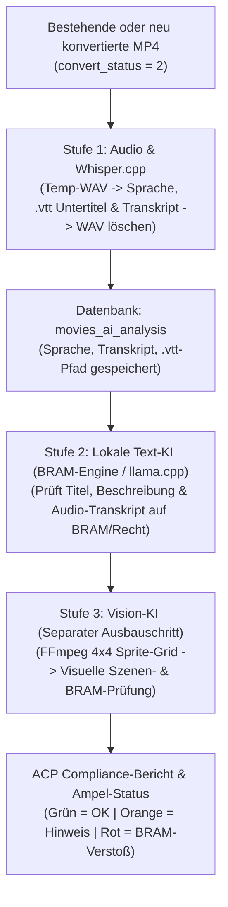

# 🤖 Lokale KI-Compliance- & Untertitel-Pipeline (Konzept & Architektur)

> **Kontext-Referenzen:** Dieses Dokument ergänzt die allgemeinen Projektvorgaben aus `@master.md`, die Dokumentations-Richtlinien aus `@documentation-standards.md` sowie den Video-Lebenszyklus aus `@video-management.md`.
> **Status:** Lebendes Architektur- & Planungsdokument (wird im Projektverlauf fortlaufend verfeinert und erweitert).

Dieses Dokument beschreibt das Gesamtkonzept sowie die schrittweise Umsetzung (Best Practice) für eine lokal auf dem EroCloud-Server betriebene KI-Pipeline zur:
1. **Audio-Auswertung & Untertitel-Generierung** (Spracherkennung, `.vtt`-Untertitel, Volltext-Transkription des gesprochenen Wortes im Video).
2. **Text-Compliance-Prüfung (Visa/Mastercard BRAM & Rechtliches)** für Creator-Eingaben (Titel, Beschreibung, SEO) sowie das gesprochene Audio-Transkript.
3. **Visuellen Video-Inhaltsanalyse (Vision-KI)** über intelligente Frame-Collagen (Sprite-Grids) in einer nachgelagerten Ausbaustufe.

---

## 1. 🖥️ Server-Hardware & Technische Rahmenbedingungen

Die Architektur ist exakt auf die physische Hardware des EroCloud-Hauptservers abgestimmt:

* **Server-Modell:** Dell Inc. PowerEdge R720 (`t199.nlserver.net`)
* **Betriebssystem:** Debian GNU/Linux 10 (Buster)
* **Prozessor (CPU):** 2x Intel(R) Xeon(R) CPU E5-2690 v2 @ 3.00GHz (**20 Kerne / 40 Threads**, 25 MB Cache, Ivy-Bridge-EP Architektur)
* **Grafikkarte (GPU):** Keine dedizierte GPU verbaut (reine CPU-Inferenz)
* **Arbeitsspeicher (RAM):** 62,86 GiB DDR3 ECC (Grundauslastung ~5 %, bis zu **32 GB RAM** für lokale KI-Prozesse verfügbar)
* **Speicherplatz (`/var/www/web1/cloud_storage`):** 5,20 TiB (aktuell ~87 % belegt – daher **strikte Vermeidung dauerhafter großer Zusatzdateien** wie unkomprimierter WAV-Audiodateien!).

### Kritische Hardware-Besonderheiten (Best Practices für Xeon E5-2690 v2):
1. **CPU-Befehlssatz (AVX1 + F16C, kein AVX2):**
   * Da die Xeon E5-2690 v2 Generation noch kein `AVX2` unterstützt, dürfen keine vorkompilierten Standard-Binaries (die `AVX2` voraussetzen) verwendet werden.
   * **Lösung:** Einsatz von **`whisper.cpp`** (für Audio/Untertitel) und **`llama.cpp`** (für Text- & Vision-LLMs), direkt auf dem Server aus dem C/C++-Quellcode mit `-DGGML_NATIVE=ON` kompiliert. Das garantiert maximale Geschwindigkeit auf allen 20 Kernen ohne Python-/PyTorch-Abhängigkeitsprobleme unter Debian 10.
2. **Kein „Safety-Refusal“ bei Adult-Content:**
   * Standard-Sprachmodelle blockieren die Auswertung expliziter Erotik-Texte. Daher werden ausschließlich **Uncensored / Abliterated** Modell-Varianten (im GGUF-Format, Quantisierung `Q4_K_M` oder `Q5_K_M`) eingesetzt, die neutral und präzise anhand unseres BRAM-Regelwerks prüfen.
3. **Ressourcenschonung gegenüber Live-Betrieb & Video-Konvertierung:**
   * KI-Prozesse laufen immer mit reduzierter Prozesspriorität (`nice -n 15`) und begrenzter Thread-Anzahl (z. B. 12–16 von 40 Threads).
   * Wenn `cronjobs/convert_movie.php` aktiv Videos konvertiert (`convert_status = '1'`), drosselt oder pausiert der Hintergrund-KI-Cronjob automatisch.

---

## 2. 🔄 Architektur-Entscheidung: Entkopplung von der Video-Konvertierung

### Warum die Extraktion NICHT fest in `convert_movie.php` eingebaut werden muss (und sollte):
* Auf dem Server liegen bereits **über 5.500 fertig konvertierte Bestandsvideos** (`convert_status = '2'`), die nachträglich analysiert werden müssen.
* Bei jedem fertig konvertierten Film (sowohl Altbestand als auch Neu-Uploads nach Abschluss der Konvertierung) liegt die fertige **Desktop-MP4 (`{id}_{file_id}.mp4`)** bereits im Film-Ordner vor.
* Aus einer bestehenden MP4-Datei extrahiert FFmpeg die für Whisper benötigte `16kHz Mono WAV`-Audiospur (`-vn -acodec pcm_s16le -ar 16000 -ac 1`) in **nur 1 bis 3 Sekunden**!
* **Speicherplatz-Vorteil:** Würde man während der Konvertierung für 5.500 Filme dauerhaft WAV-Dateien aufheben, würde das über **150 GB Speicherplatz** verschwenden. Stattdessen erzeugt der Analyse-Prozess die `.wav`-Datei *just-in-time* aus der `.mp4`, übergibt sie direkt an `whisper.cpp`, speichert die winzige `.vtt`-Untertiteldatei (wenige Kilobyte) sowie das Text-Transkript in der Datenbank und **löscht die temporäre `.wav`-Datei sofort wieder (`unlink`)**.
* **Einheitlicher Workflow:** Dadurch funktioniert ein und derselbe Prozess zu 100 % identisch für das **Testen an einem einzelnen Video**, für die **Nachbearbeitung aller >5.500 Bestandsvideos** und für **alle zukünftig hochgeladenen Videos** (sobald `convert_status = '2'` erreicht ist).

---

## 3. 🧱 Die 4 Ausbaustufen (Phasen-Planung)

Um volles Vertrauen in die Ergebnisse, die Geschwindigkeit und die Erkennungsqualität auf dem Live-Server zu gewinnen, wird das System strikt modular von Phase 1 bis Phase 4 aufgebaut:

### Phase 1: Einzel-Video-Testlabor im ACP (Proof of Concept & Feinjustierung – AKTIV)
Im Admin Control Panel (ACP) unter `/KI-Analyse` (`acp/includes/ai_compliance.php`) steht das **interaktive Test-Cockpit** bereit:
1. **Gezielte Video-Auswahl:**
   * Eingabe einer beliebigen `movie_id` (oder Auswahl aus einer Liste hochgeladener Creator-Videos).
   * Anzeige der aktuellen Film-Metadaten (Titel, Beschreibung, Kategorien, Laufzeit, Dateipfad der `.mp4`, Status).
2. **Manueller Test-Button für Modul A (Audio -> Untertitel & Transkript):**
   * Klick auf **„1. Audio & Untertitel jetzt extrahieren (Whisper)“**:
   * Extrahiert temporär die Audiospur der gewählten MP4, führt `whisper.cpp` aus und löscht die temporäre WAV-Datei.
   * **Sofort-Anzeige im ACP:**
     * Erkannte Sprache (z. B. `DE (98.4 %)` oder `Stummfilm`).
     * Benötigte Server-Rechenzeit (z. B. `14,2 Sek. bei 12 Threads`).
     * Vorschau der erzeugten `.vtt`-Untertiteldatei + vollständiges Text-Transkript mit Zeitstempeln (`[00:12 - 00:18] ...`).
     * Speicherung in der Datenbank (`movies_ai_analysis`).
3. **Manueller Test-Button für Modul B (Text- & Transkript-Compliance):**
   * Klick auf **„2. Texte & Transkript mit KI auf BRAM prüfen“**:
   * Prüft Filmtitel, Filmbeschreibung, SEO-Metadaten und das aus Modul A gewonnene Audio-Transkript gegen das zweistufige BRAM-Regelwerk.
   * Über ein direkt im ACP anpassbares **Regel-/Prompt-Feld** können verbotene Begriffe und BRAM-Kriterien live getestet und verfeinert werden.
   * **Sofort-Anzeige im ACP:**
     * Compliance-Ampel (**Grün / Orange / Rot**) & Risiko-Score (`0–100`).
     * Konkrete Begründung, welche Textstelle im Titel, in der Beschreibung oder bei welcher Sekunde im gesprochenen Video-Text verdächtig ist.

### Phase 2: Gesteuerter Batch-Lauf & Hintergrund-Cronjob (Bestand >5.500 Videos + Neu-Uploads – AKTIV)
1. **Batch-Steuerung im ACP (`/KI-Analyse` -> Tab 2):**
   * Buttons für kontrollierte Testläufe, **15-Sekunden-Katalog-Schnellscan** für alle Video-Titel/Beschreibungen in 250er-Paketen sowie ein **Live-Browser-Batch** mit 2-Sekunden-Status-Ticker.
   * Live-Fortschrittsbalken: *„X von 5.550 Videos haben bereits Untertitel & Transkript“* / *„Y von 5.550 Videos sind KI-Text-geprüft“*.
2. **Hintergrund-Cronjob (`cronjobs/ai_compliance_worker.php`):**
   * Prüft bei jedem Aufruf zuerst: Läuft gerade eine Video-Konvertierung (`convert_status = '1'`)? Falls ja -> automatische Pause.
   * Arbeitet schrittweise alle konvertierten Videos (`convert_status = '2'`) ab, bei denen noch keine Untertitel bzw. noch keine BRAM-Prüfung hinterlegt sind.

### Phase 3: Integration in die ACP-Videoprüfung (`movie_checking.php`), Bearbeitung (`movie_edit.php`) & Filmlisten (AKTIV)
* **DataTables-Listen (`/Filme-online` & `/Filme-pruefen`)**:
  * Zeigen in einer eigenen Spalte das farbige BRAM-Risiko-Score-Badge (`aic_render_bram_score_badge()`):
    * **Rot (`violation`)**: Kritischer BRAM-/Rechts-Verstoß (`#dc3545`).
    * **Orange (`warning`)**: Prüfhinweis / Spezialfetisch ohne Kreditkarte (`#e0a800`).
    * **Grün (`ok` + Audio geprüft)**: Vollständig geprüft – Text & Audio unbedenklich (`#28a745`).
    * **Info-Blau/Türkis (`ok` + Audio noch offen)**: `5 / 100 (Nur Text)` – Vorab-Textcheck unauffällig, Audio-Transkription durch den Whisper-Cronjob steht noch aus (`#17a2b8`).
  * Bei noch ungeprüften Filmen in `/Filme-pruefen` wird die Erstbewertung (`aic_analyze_texts()`) beim Laden der Tabelle automatisch live berechnet und in `movies_ai_analysis` persistiert.
* **Detailseiten (`/Film-pruefen/{id}` & `/Film-bearbeiten/{id}`)**:
  * Zeigen direkt oberhalb des Bearbeitungsformulars ein **Top-Compliance-Banner** (`aic_get_movie_bram_and_ai_tabs_data()`) inkl. Risiko-Score, Ampel-Empfehlung und farbigen Fundstellen-Pills (mit Textzitat im Tooltip). Beim Speichern von Änderungen wird der BRAM-Score sofort neu berechnet (`$force_recalc = true`).
  * Zusätzlich stehen zwei eigene jQuery-UI-Tabs direkt in der Filmprüfung/-bearbeitung bereit:
    * **Tab „BRAM & KI-Analyse“ (`#tab-bram`)**: Detailkarten, Fundstellen-Tabelle mit Zeitstempeln, Übersicht der bereinigten Textquellen und 1-Klick-Neuprüfung.
    * **Tab „Audio & Transkript (.vtt)“ (`#tab-transcript`)**: Live-Trigger für die Whisper-Transkription dieses einzelnen Films, Sprachanzeige, editierbares Audio-Transkript und WebVTT-Untertitelvorschau.

### Phase 4: Visuelle Video-Analyse (Vision-KI / Frame-Collagen)
Als komplett eigenständiges Modul (nachgelagerter Ausbauschritt):
* FFmpeg erstellt aus der bestehenden `.mp4` ein **4x4 Sprite-Grid** (`16 Szenen` gleichmäßig über den Film verteilt auf einem einzigen Bild inkl. eingebranntem Zeitstempel).
* Ein lokales Vision-Modell analysiert dieses Übersichtsbild auf visuelle BRAM-Verstöße (Gewalt, Waffen, Blut, Fesselung/Zwang, eingeblendete Fremd-URLs/Watermarks) und erstellt eine visuelle Inhaltszusammenfassung in `movies_ai_analysis`.

---

## 4. 🗄️ Datenbank-Schema (`movies_ai_analysis`)

Um die Kerntabelle `movies` sauber zu halten und für jedes der >5.500 Videos jederzeit abfragen zu können, welcher Schritt bereits erledigt ist, wird die dedizierte Tabelle `movies_ai_analysis` verwendet:

| Spalte | Typ | Beschreibung |
| :--- | :--- | :--- |
| `movie_id` | `INT(11) UNSIGNED PRIMARY KEY` | Verknüpfung zu `movies.id` |
| `merchant_id` | `INT(11) UNSIGNED INDEX` | Verknüpfung zu `movies.merchant_id` |
| `subtitle_status` | `TINYINT(1) DEFAULT 0` | `0` = Offen, `1` = In Arbeit, `2` = Erstellt, `3` = Kein Audio/Stumm, `4` = Fehler |
| `detected_language` | `VARCHAR(16) DEFAULT ''` | ISO-Sprachcode aus Whisper (z. B. `de`, `en`, `es`, `fr`) |
| `language_confidence` | `DECIMAL(5,2) DEFAULT 0.00` | Sicherheit der Spracherkennung in Prozent (z. B. `98.40`) |
| `subtitle_filename` | `VARCHAR(255) DEFAULT ''` | Dateiname der erzeugten `.vtt`-Datei im Film-Ordner (`sub_{id}_{file_id}.vtt`) |
| `spoken_transcript` | `MEDIUMTEXT` | Vollständiger aus dem Video extrahierter Text (bereinigter Reintext mit Zeitstempeln) |
| `spoken_segments_json`| `MEDIUMTEXT` | JSON-Array der bereinigten Textsegmente mit Start-/End-Zeitstempeln (`start`, `end`, `text`) |
| `whisper_duration_sec`| `DECIMAL(7,2) DEFAULT 0.00` | Benötigte Rechenzeit für die Audio-Transkription in Sekunden |
| `text_check_status` | `TINYINT(1) DEFAULT 0` | `0` = Offen, `1` = In Arbeit, `2` = Geprüft, `3` = Fehler |
| `text_compliance` | `VARCHAR(20) DEFAULT 'pending'` | `pending`, `ok`, `warning`, `violation` |
| `text_risk_score` | `TINYINT(3) UNSIGNED DEFAULT 0` | Risikobewertung der KI von `0` (unbedenklich) bis `100` (schwerer Verstoß) |
| `text_engine_used` | `VARCHAR(64) DEFAULT ''` | Verwendete Prüf-Engine (z. B. `BRAM-Regel-Engine (JSON v1.1)`) |
| `text_summary` | `TEXT` | Kurze deutsche Zusammenfassung der KI zum Inhalt & gesprochenen Text |
| `text_violations_json`| `MEDIUMTEXT` | JSON-Liste gefundener Verstöße (Kategorie, Zitat, Quelle: Titel/Beschreibung/Audio-Minute) |
| `text_duration_sec` | `DECIMAL(7,2) DEFAULT 0.00` | Benötigte Rechenzeit der Text-KI in Sekunden |
| `vision_check_status` | `TINYINT(1) DEFAULT 0` | *(Für Phase 4)* `0` = Offen, `1` = In Arbeit, `2` = Geprüft, `3` = Fehler |
| `vision_compliance` | `VARCHAR(20) DEFAULT 'pending'` | *(Für Phase 4)* Ergebnis der visuellen Bild-Analyse |
| `vision_report_json` | `MEDIUMTEXT` | *(Für Phase 4)* JSON-Bericht der visuellen Video-Analyse |
| `last_error` | `VARCHAR(500) DEFAULT ''` | Fehlerprotokoll falls FFmpeg, Whisper oder LLM fehlschlagen |
| `created_at` | `DATETIME` | Zeitstempel der ersten Erstellung |
| `updated_at` | `DATETIME` | Zeitstempel der letzten Aktualisierung |

---

## 5. 🛡️ Geprüfte Compliance-Kategorien (Visa / Mastercard BRAM & Gesetz)

Die lokale KI wird über ein striktes System-Prompt-Regelwerk angewiesen, sowohl **direkte Begriffe** als auch **Umschreibungen / Codewörter** in folgenden Bereichen zu melden:
1. **Minderjährigkeit / Age-Play:** Begriffe oder Rollenspiele, die unter 18-Jährige suggerieren (*Schoolgirl, Teen-Abuse, zu jung, „gerade 18“ im bedenklichen Kontext*).
2. **Fehlende Einvernehmlichkeit (Non-Consensual / Gewalt):** Zwang, Vergewaltigungs-Rollenspiele, echt wirkende Schmerzensschreie/Hilferufe im Audio-Transkript (*„Hör auf“, „Nein“* im nicht-einvernehmlichen Kontext), Erpressung.
3. **Bewusstlosigkeit / K.O.-Mittel (Hard-Block Rot):** Schlafende Personen, K.O.-Tropfen, Ohnmacht, schwere Trunkenheit/Drogen.
4. **Inzest / Blutsverwandtschaft:** Direkte familiäre Bezeichnungen (*Vater, Mutter, Bruder, Schwester, Tochter, Sohn* = Rot; mit „Stief-“ als Warnstufe `warning` / Gelb zur manuellen Admin-Sichtung).
5. **Extreme Gewalt & Illegalität (Hard-Block Rot):** Blut, Wunden, Waffen, Ersticken/Strangulation, Tier-Bezug (Zoophilie § 184a StGB).
6. **Spezielle Fetische ohne Kreditkarten-Erlaubnis (Prüfhinweis Gelb – `warning`):**
   * **KV (Kaviar / Scheiße / Kot), NS (Natursekt / Urin), Poppers & Hypnose:** Verstoßen zwar gegen die Visa/Mastercard BRAM-Richtlinien, sind bei EroCloud aber auf speziellen Fetisch-Partnerseiten **ohne Kreditkarten-Zahlung** erlaubt. Sie werden daher bewusst **gelb (`warning`, Score 70)** markiert mit dem Hinweis: *„Nur auf Seiten OHNE Kreditkarte erlaubt!“*.
7. **Unerlaubte Eigenwerbung / Abwerbung (Prüfhinweis Gelb – `warning`):** Gesprochene oder geschriebene Hinweise auf externe Bezahlmethoden, PayPal, Überweisung, Telegram, OnlyFans oder private Treffen/Escort.

---

## 6. 🧹 Intelligente Whisper-Sprach-Whitelist, Anti-Halluzinations-Filter & VTT-Normalisierung

Da `whisper.cpp` bei Videos, die in den ersten 30 Sekunden überwiegend aus Stöhnen, Atmen oder Hintergrundmusik bestehen, unter `-l auto` gelegentlich exotische Sprachen (`nn`, `ko`, `ja`, `jw`, `la`, `zh`) rät oder TV-/YouTube-Untertitel-Fragmente halluziniert, verfügt [`includes/ai_compliance_core.inc.php`](file:///c:/xampp/htdocs/EroCloud/includes/ai_compliance_core.inc.php) über eine mehrstufige Qualitäts- & Bereinigungspipeline:

1. **Europäische Sprach-Whitelist (`aic_get_allowed_whisper_languages()`) & Auto-Retry-Fallback**:
   * Erlaubte Zielsprachen: `de`, `en`, `es`, `fr`, `it`, `nl`, `pl`, `cs`, `ru`, `pt`, `tr`, `hu`, `sv`, `da`.
   * Erkennt `whisper-cli` mit `-l auto` eine Sprache außerhalb dieser Whitelist **und** enthält das Transkript echten Text außerhalb von Klammer-Tags, führt [`aic_process_single_movie_pipeline()`](file:///c:/xampp/htdocs/EroCloud/includes/ai_compliance_core.inc.php#L998-L1219) vor dem Löschen der temporären `.wav`-Datei sofort automatisch einen zweiten Whisper-Durchlauf mit der hinterlegten Filmsprache (`movies.movie_language`, Fallback `de`) durch.
2. **Atmosphären-Tag-Normalisierung (`aic_normalize_single_bracket_tag()`)**:
   * Vereinheitlicht alle sinnvollen fremdsprachigen oder variierenden Klammer-/Sternchen-Ausdrücke (`[moaning]`, `(sighs)`, `*heavy breathing*`, `[music playing]`, `[she laughs]`, kurze IPA-Laute wie `[ ˈbɑː ]`) auf 5 saubere deutsche Standard-Tags:
     * `[Musik]`, `[Stöhnen]`, `[Schweres Atmen]`, `[Lachen]`, `[Klatschen]`
   * Entfernt bekannte Whisper-Halluzinationen (`Untertitel im Auftrag des ZDF`, `Amara.org`, `drillenzel`, `[indistinct]`, fremde Schriftsysteme wie Koreanisch/Japanisch/Chinesisch/Arabisch) restlos.
3. **Zeitspannen-Verschmelzung gegen Untertitel-Flackern (`aic_clean_and_normalize_segments()`)**:
   * Aufeinanderfolgende Segmente mit demselben Atmosphären-Tag (z. B. `[Stöhnen]` über mehrere Minuten hinweg, mit Pausen $\le 12$ Sekunden) werden zu **einem einzigen durchgehenden Zeitblock** (z. B. `[00:08 - 06:51] [Stöhnen]`) verschmolzen, statt im 2-Sekunden-Takt im Player aufzublinken.
   * Identische 1-Wort-Ausrufe (`Oh.`, `Ah.`, `Ja.`) innerhalb von 4,5 Sekunden werden dedupliziert.

---

## 7. 📍 Implementierte Dateien, Workflows & 5-Tab-Cockpit (`/KI-Analyse`, Stand: Phase 1–3 aktiv)

> **Server-Installations-Details:** Alle Linux-/Debian-10-spezifischen Kompilierungsschritte (`whisper.cpp`, CMake/GCC-Patches, Modell-Pfade unter `/var/www/web1/priv/ai/`) sind im Detail in `@ai-server-installation-guide.md` dokumentiert.

1. **Zentrale Kern-Bibliothek (`includes/ai_compliance_core.inc.php`)**:
   * [`includes/ai_compliance_core.inc.php`](file:///c:/xampp/htdocs/EroCloud/includes/ai_compliance_core.inc.php): Gemeinsame Funktionsbibliothek für das ACP-Cockpit, die Filmprüfung/-bearbeitung und den Hintergrund-Cronjob:
     * `aic_ensure_table()`: Erstellt und verwaltet automatisch die Datenbanktabelle `movies_ai_analysis`.
     * `aic_check_environment()`: Prüft den Live-Status von `FFmpeg`, `whisper.cpp` (`ggml-small-q5_1.bin` & `ggml-large-v3-turbo-q5_0.bin`) sowie `llama.cpp` / `Ollama` (inkl. `open_basedir`-Fallback `aic_file_or_exec_exists()`).
     * `aic_get_allowed_whisper_languages()`, `aic_normalize_single_bracket_tag()` & `aic_clean_and_normalize_segments()`: Sprach-Whitelist, Halluzinations-Filter, Tag-Vereinheitlichung und Zeitblock-Verschmelzung.
     * `aic_process_single_movie_pipeline()`: Extrahiert temporär die 16kHz-Mono-WAV aus der bestehenden `.mp4`, führt `whisper-cli` mit `nice -n 15 -bs 1 -bo 1` (inkl. automatischem Sprach-Fallback) aus, bereinigt die Segmente, schreibt die `.vtt`-Untertiteldatei (`sub_{id}_{file_id}.vtt`) in den Filmordner, löscht die temporäre `.wav`-Datei sofort wieder und führt die BRAM-Textprüfung aus.
     * `aic_analyze_texts()`: Kombiniert Filmtitel, Beschreibung, SEO-Metadaten und das gesprochene Video-Transkript (nach HTML-/Entity-Bereinigung durch `aic_clean_html_text()`) und prüft sie gegen das BRAM-Regelwerk sowie optional gegen das lokale Sprachmodell (`llama.cpp`).
     * `aic_render_bram_score_badge()`, `aic_render_movie_detail_bram_box()` & `aic_get_movie_bram_and_ai_tabs_data()`: UI-Renderer für die Tabellen `/Filme-online` (`acp/includes/movies_online.php` & `acp/includes/ajax/movies_online.php`) und `/Filme-pruefen` (`acp/includes/movies_checking.php` & `acp/includes/ajax/movies_checking.php`, inkl. Auto-Erstbewertung beim Laden) sowie die Detail-Tabs („BRAM & KI-Analyse“ und „Audio & Transkript (.vtt)“) und das Top-Compliance-Banner in `/Film-bearbeiten/{id}` (`acp/includes/movie_edit.php`) und `/Film-pruefen/{id}` (`acp/includes/movie_checking.php`).
2. **BRAM-Regelwerk, Prompt & Batch-Konfiguration (`includes/ai_rules/`)**:
   * [`includes/ai_rules/bram_system_prompt.md`](file:///c:/xampp/htdocs/EroCloud/includes/ai_rules/bram_system_prompt.md): Vollständiger Markdown-System-Prompt für die lokale Prüf-KI (`llama.cpp`), unterteilt in **Kategorie 1: ROT (`violation` / Universeller Hard-Block)** und **Kategorie 2: GELB (`warning` / Nur auf Portalen ohne Kreditkartenabrechnung zulässig: KV, Scheiße, NS, Natursekt, Poppers, Hypnose + Grauzonen/Abwerbung)**.
   * [`includes/ai_rules/bram_keyword_rules.json`](file:///c:/xampp/htdocs/EroCloud/includes/ai_rules/bram_keyword_rules.json): Strukturierter DE/EN Keyword- & Wortstamm-Katalog inkl. `fetish_no_creditcard` (`warning`, Basis-Score 70).
   * [`includes/ai_rules/batch_config.json`](file:///c:/xampp/htdocs/EroCloud/includes/ai_rules/batch_config.json): Persistente Konfiguration für den Hintergrund-Cronjob (`cron_enabled`, `whisper_model_pref`, `whisper_threads`, `audio_limit_sec`, `order_direction`, `pause_on_ffmpeg_convert`, `max_movies_per_run`, `sync_empty_movie_lang`).
   * `includes/ai_rules/batch_status.json`: Laufzeit-Heartbeat des Workers (aktuell verarbeitete `movie_id`, letzte Meldung, Zeitstempel, Gesamtzähler).
3. **Hintergrund-Cronjob (`cronjobs/ai_compliance_worker.php`)**:
   * [`cronjobs/ai_compliance_worker.php`](file:///c:/xampp/htdocs/EroCloud/cronjobs/ai_compliance_worker.php) (dokumentiert in [`cronjobs/jobs.txt`](file:///c:/xampp/htdocs/EroCloud/cronjobs/jobs.txt)):
     * Wird über LiveConfig / Crontab alle 2 Minuten aufgerufen (`*/2 * * * * /usr/bin/php /var/www/web1/htdocs/cronjobs/ai_compliance_worker.php >/dev/null 2>&1`).
     * Verhindert Überlappungen durch `flock()` auf `/var/www/web1/priv/tmp/erocloud_ai_worker.lock` und pausiert automatisch, sobald `convert_movie.php` aktiv Videos konvertiert (`convert_status = 1`).
4. **ACP-Routing, Navigation & 5-Tab-Cockpit (`/KI-Analyse`)**:
   * [`acp/.htaccess`](file:///c:/xampp/htdocs/EroCloud/acp/.htaccess) & [`acp/index.php`](file:///c:/xampp/htdocs/EroCloud/acp/index.php): Route `/KI-Analyse` unter **Content Prüfen → KI-Analyse & BRAM**.
   * [`acp/includes/ai_compliance.php`](file:///c:/xampp/htdocs/EroCloud/acp/includes/ai_compliance.php) & [`acp/includes/ajax/ai_compliance_action.php`](file:///c:/xampp/htdocs/EroCloud/acp/includes/ajax/ai_compliance_action.php):
     * **Tab 1 (Einzel-Video-Testlabor):** Auswahl eines Videos, Live-Whisper-Test mit wählbarem Audio-Umfang, editierbare Vorschau von Transkript & `.vtt`, detaillierter BRAM-Prüfbericht.
     * **Tab 2 (Batch- & Cronjob-Steuerung):** Fortschrittsbalken für alle >5.500 Videos, 15-Sekunden-Katalog-Schnellscan für alle Video-Titel/Beschreibungen in 250er-Paketen, Live-Browser-Batch mit 2-Sekunden-Status-Ticker und Server-Cronjob-Konfiguration.
     * **Tab 3 (Regelwerk & KI-Prompt):** Live-Editor für `bram_system_prompt.md` und `bram_keyword_rules.json`.
     * **Tab 4 (Analyse-Historie):** Schnellfilter nach BRAM-Ampel (`Rot`, `Gelb / Ohne KK`, `Grün`), Untertitel-Status (`.vtt vorhanden`, `Stummfilm`, `Offen`, `Fehler`) und Volltext-/ID-Suche.
     * **Tab 5 (`.vtt` Transkript-Inspektor):** Seitenweise Qualitätskontrolle aller erzeugten `.vtt`-Untertitel inkl. 1-Klick-Zwischenablage-Export, JSON-Download sowie dem Aktions-Button **„Alle bestehenden Transkripte & .vtt jetzt bereinigen + Fehlsprachen neu einreihen“** (`clean_and_requeue_all_transcripts`), der bestehende Datenbank-Segmente und `.vtt`-Dateien rückwirkend normalisiert, BRAM-Scores aktualisiert und Filme mit echten fremdsprachigen Halluzinationen automatisch für den Whisper-Cronjob zurücksetzt (`subtitle_status = 0`).

---

## 8. 🌍 Lokale KI-Übersetzungsmöglichkeiten (Audio & Text)

Für mehrsprachige Ausspielungen (Titel, Beschreibungen, SEO-Metadaten, Darsteller-Texte oder mehrsprachige `.vtt`-Untertitel) bietet die lokale KI-Infrastruktur auf dem EroCloud-Server zwei komplementäre Wege:

1. **Audio-zu-Englisch via `whisper.cpp` (bereits installiert)**:
   * `whisper-cli` unterstützt nativ den Parameter `--translate` (bzw. `-tr`), mit dem gesprochenes Audio aus jeder Ausgangssprache direkt in englische `.vtt`-Untertitel übersetzt werden kann.
   * **Einschränkung:** `whisper.cpp` ist ein reines Speech-to-Text-Modell (`Audio -> Text`). Es kann keine geschriebenen Datenbanktexte (wie Filmtitel oder Beschreibungen) übersetzen und beherrscht bei der direkten Audio-Übersetzung als Zielsprache ausschließlich Englisch.
2. **Beliebige Text- & `.vtt`-Übersetzungen via lokalem Sprachmodell (`llama.cpp` / `Ollama` – vorbereitet in `aic_check_environment()`)**:
   * Über den bereits in [`includes/ai_compliance_core.inc.php`](file:///c:/xampp/htdocs/EroCloud/includes/ai_compliance_core.inc.php#L273-L308) vorbereiteten lokalen Endpunkt (`http://127.0.0.1:8080/v1/chat/completions` für `llama.cpp` bzw. `http://127.0.0.1:11434/api/chat` für `Ollama`) kann ein lokal auf der CPU betriebenes GGUF-Sprachmodell (z. B. *Qwen 2.5 7B Instruct Q4_K_M* oder *Llama 3.1 / Mistral 7B Uncensored*, RAM-Bedarf nur ~4,5–5,5 GB) angebunden werden.
   * **Vorteile für EroCloud:**
     * Übersetzt geschriebene **Filmtitel, Filmbeschreibungen, SEO-Tags sowie bestehende `.vtt`-Untertitel-Segmente** in beliebige Zielsprachen (`DE <-> EN, FR, ES, IT, NL, PL` usw.).
     * **Keine Zensur / Kein API-Block:** Im Gegensatz zu externen Cloud-Übersetzern (DeepL, Google, OpenAI) blockiert oder verfälscht ein lokales Uncensored/Instruct-Modell explizite Adult- und Fetisch-Begriffe nicht und verursacht keinerlei laufende API-Kosten pro Wort.
