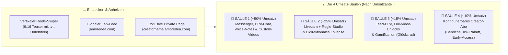

# 🚀 Amoredea Next-Gen Portal – Konzept & Architektur (`amoredea.com` & `*.amoredea.com`)

> **Kontext-Referenzen:** Dieses Dokument ergänzt die globalen Vorgaben aus `@master.md`, die Server-Dokumentation `@server-and-system-environment.md`, die MCP-Architektur `@mcp-modernization-architecture.md` sowie die KI-Pipeline `@ai-compliance-and-subtitle-pipeline.md`.
> **Status:** Verbindliches Grundkonzept & strategische Leitplanken für den geplanten Greenfield-Neubau von `amoredea.com` (`web2`). Detailplanung erfolgt in einer späteren Phase (`/grill-me` / `/plan`).

---

## 1. 🎯 Vision & Strategischer „Unfair Advantage“

Das bestehende, veraltete `amoredea.com`-System (aktuell auf `web2` unter `PHP 7.3.33`) wird komplett entsorgt und als hochmodernes **Next-Gen Fan-, Video-, Messenger- und Livecam-Portal** unter **PHP 8.4.27** neu aufgebaut.

Das Portal vereint die **umsatzstärksten Mechanismen** aus **OnlyFans, BestFans, MyDirtyHobby (MDH), Fansly und Stripchat** und kombiniert sie mit der bestehenden Infrastruktur von **EroCloud**, **Pay4Coins** und **EroCMS**:

1. **Null Cold-Start-Problem:**
   Über **5.500 fertig konvertierte Filme**, tausende Fotoalben, Darsteller-Profile (`actors`), rechtssichere Co-Actor-Freigaben (`co_actors` inkl. QR-ID-Check & Model-Release) sowie die **KI-Compliance- & Whisper-`.vtt`-Untertitel-Pipeline** (`movies_ai_analysis`) stehen ab Tag 1 direkt aus der EroCloud bereit.
2. **Keine doppelte Datenhaltung:**
   Da `amoredea.com` (`web2`) und EroCloud (`web1`) auf demselben Produktionsserver (`t199.nlserver.net`) liegen, greift Amoredea direkt auf `/var/www/web1/cloud_storage` zu. Kein Video und kein Fotoalbum muss doppelt hochgeladen oder doppelt gespeichert werden.
3. **Ein einziges Creator-Cockpit (im EroCloud MCP `mcp_neu`):**
   Sowohl das **Creator Studio** als auch das **Regie-Studio** werden direkt als Module in das moderne **EroCloud MCP (`mcp_neu`)** integriert. Creatorinnen verwalten ihren gesamten Content, ihre Private Page, ihren Messenger und ihre Livecam-Shows über **einen einzigen Login (Pay4Coins SSO)**.
4. **Infrastruktur-Bereinigung auf `t199.nlserver.net`:**
   Mit der Ablösung des alten `amoredea.com` entfällt die letzte `PHP 7.3.33`-Abhängigkeit auf dem Server, wodurch auch der Weg für künftige Debian-Upgrades frei wird.

---

## 2. ✅ Festgelegte strategische Kern-Entscheidungen (Stand: Oktober 2026)

| Nr. | Bereich | Festgelegte Entscheidung |
| :--- | :--- | :--- |
| **1** | **Dual-Portal (`amoredea.com` + `creatorname.amoredea.com`)** | **100 % geschlossener „Solo-Modus“ auf der Subdomain:** Auf `creatorname.amoredea.com` sind **keine anderen Girls sichtbar** und kein Abwandern zu fremden Profilen möglich (perfekt für eigenen Instagram-/TikTok-/Linktree-Traffic der Creatorin, optional mit höherer „Bring-Your-Own-Fan“-Provision). Auf der Hauptdomain `amoredea.com` hingegen sind alle Creatorinnen im globalen Entdecker-Portal vereint. |
| **2** | **Verortung von Creator Studio & Regie-Studio** | **Direkte Integration ins EroCloud MCP (`mcp_neu`):** Creator Studio (Feed-Planer, Auto-Reels, Mass-DMs) und Regie-Studio (Livecam-Cockpit, Overlays, In-Stream Video-Drops, Lovense) ziehen direkt als zentrale Module ins neue EroCloud MCP ein. |
| **3** | **Bidirektionale Lovense-Integration (Fan $\leftrightarrow$ Creatorin / Herrin)** | **Visuelle Reaktion + Femdom-Steuerung:** • **Richtung A (User steuert Creatorin):** Hauptfokus auf **sichtbarer Live-Reaktion** der Creatorin (im Livecam-/Regie-Studio und im 1-on-1 Video-Call; im Messenger optional/mit Video-Reaktion). • **Richtung B (Creatorin / Herrin / Lady / Domina steuert Toys des Users):** Die Creatorin kann im Regie-Studio oder 1-on-1 Chat auch **verbundene Lovense-Toys des Users** (z. B. Hush, Max 2, Edge, Gush, Solace) live fernsteuern – ein massives Alleinstellungsmerkmal für den zahlungskräftigen Femdom-/Domina-Markt! |
| **4** | **Konfigurierbares Hybrid- & Abo-Modell** | **Flexibel durch die Creatorin einstellbar:** Kombination aus Einzelkauf (Pay4Coins Instant-Unlock) und einem optionalen **Abo / VIP-Pass**, dessen Vorteile die Creatorin selbst konfigurieren kann: • **Bereichs-Freigabe:** Abo schaltet bestimmte Bereiche frei (z. B. exklusiver VIP-Feed, Fotoalben oder Storys). • **Individueller Abo-Rabatt:** Abonnenten erhalten **X % Rabatt** auf alle regulären Videos/Alben der Creatorin. • **Early-Access (Vorab-Zugriff):** Neue Videos gehen für Abonnenten **früher online** (z. B. X Tage vor dem regulären Einzelverkauf). |
| **5** | **Gamifizierter Subdomain-Unlock (`creatorname.amoredea.com`)** | **Im ACP einstellbar + Fortschrittsbalken im MCP:** Die Schwellenwerte für die automatische Freischaltung der eigenen Private Page (z. B. *Mindestanzahl Videos in der EroCloud*, *tägliche/wöchentliche Feed-Posts* oder *Anzahl aktiver User-Interaktionen*) sind im **ACP** flexibel konfigurierbar und werden der Creatorin im **MCP** als motivierender Gamification-Fortschrittsbalken angezeigt. |

---

## 3. 💰 Die 4 Umsatz-Säulen (Umsatzstärkste Funktionen im Vordergrund)

Die Plattform-Architektur und das UI/UX priorisieren konsequent jene Funktionen, für die Nutzer statistisch das meiste Geld ausgeben:

### 🥇 Säule 1 (~45–55 % Umsatz): High-Conversion Messenger & PPV-Sexting
* **Blurred Vault Media (1-Klick-PPV im Chat):** Creatorinnen hängen Fotos, Kurzclips oder komplette EroCloud-Filme direkt im Chat an. Der User sieht eine edel verschwommene Vorschau (inkl. Spielzeit, Audio-Indikator & Coin-Preis) und schaltet sie per 1-Tap-Pay4Coins-Unlock sofort im Chat frei.
* **Paid Voice-Notes (Sprachnachrichten gegen Coins):** Authentische Sprachnachrichten der Creatorin mit sichtbarer Audio-Wellenform, die für einen kleinen Coin-Betrag freigeschaltet werden.
* **Mass-DM Kampagnen (Personalisierte Rundnachrichten):** Versand neuer Videos oder exklusiver Snaps als PPV-Nachricht an definierte Fan-Segmente (z. B. alle bisherigen Käufer oder Top-Tipper).
* **Whale-Radar & Fan-CRM im Messenger-Cockpit:** Zeigt der Creatorin neben dem Chatverlauf sofort die wichtigsten Kaufdaten des Users (Coin-Guthaben, bisherige Ausgaben bei ihr, gekaufte Kategorien/Fetische, Abo-Status).

### 🥈 Säule 2 (~20–25 % Umsatz): Livecam, Regie-Studio & Bidirektionales Lovense
* **Browser-Regie-Studio (wie im EroCMS, direkt im MCP):**
  * **Live-Overlays:** Animierte Tip-Goals (*„Noch 350 Coins bis Outfit-Wechsel“*), interaktives Tip-Menü im Videobild, Live-Umfragen und Glücksrad-Einblendung.
  * **In-Stream Video-Drops („Live-Shopping“):** Die Creatorin wirft während des Livestreams ein passendes EroCloud-Video als klickbare Kauf-Karte (optional mit Stream-Rabatt) direkt auf den Bildschirm aller Zuschauer.
  * **1-Klick Highlight-Clipper:** Schneidet die letzten 30 Sekunden eines heißen Live-Moments automatisch mit und veröffentlicht sie sofort als verschwommenen PPV-Post im Fan-Feed.
* **Bidirektionale Lovense-Steuerung:**
  1. **User $\rightarrow$ Creatorin (mit Live-Reaktionsbild):** Coin-Tips im öffentlichen Stream oder im 1-on-1 VIP-Video-Call steuern live das Toy der Creatorin (Lush, Domi, Ferri etc.), sodass der User ihre körperliche Reaktion direkt im Kamerabild sieht und hört (optional auch als Kurz-Reaktions-Feature im Messenger).
  2. **Creatorin / Herrin / Domina $\rightarrow$ User (Femdom Remote Control):** Im speziellen **„Herrin-/Domina-Modus“** verbindet der devotee User sein eigenes Lovense-Toy (z. B. Hush, Max 2, Edge, Gush, Solace) über eine Session-Freigabe. Gegen Tribut/Coins (oder Minutenabrechnung) erhält die Domina in ihrem Regie-Studio ein Live-Control-Panel (Schieberegler, Muster, „Shock/Max“-Button), um den User vor laufender Cam oder im 1-on-1 Session-Chat live zu steuern.

### 🥉 Säule 3 (~15–20 % Umsatz): Hybrider Fan-Feed, Reels & Einzelkauf
* **Keine blinde Sperrwand für Neukunden:** Anders als bei OnlyFans sehen neue Besucher auf `amoredea.com` und `creatorname.amoredea.com` sofort eine lebendige Timeline aus kostenlosen Appetizern, 9:16 Kurz-Reels (mit eingebrannten `.vtt`-Untertiteln für tonloses Smartphone-Swipen) und einzeln freischaltbaren PPV-Posts sowie langen EroCloud-Videos.
* **In-Feed Gamification:** Interaktive Module wie ein Creator-Glücksrad (*„Drehe für 50 Coins – 100 % Gewinnchance auf ein exklusives Foto, Sprachnachricht oder Video-Rabatt“*).

### 🏅 Säule 4 (~10 % Umsatz): Das flexibel einstellbare Creator-Abo (VIP-Pass)
Jede Creatorin kann im Creator Studio (`mcp_neu`) selbst entscheiden, ob und mit welchen Vorteilen sie ein Monats-/30-Tage-Abo anbietet:
* **Option A – Exklusive Abo-Bereiche:** Bestimmte Feed-Kategorien, Storys oder Fotoalben sind automatisch für aktive Abonnenten freigeschaltet („Nur für meine VIPs“).
* **Option B – Einstellbarer Video-Rabatt:** Abonnenten erhalten automatisch **X % Rabatt** (frei wählbar durch die Creatorin, z. B. 15 %, 25 % oder 50 %) auf alle ihre EroCloud-Videos und PPV-Medien.
* **Option C – Early-Access (Vorab-Veröffentlichung):** Neue Videos der Creatorin sind in den ersten **X Tagen** exklusiv für Abonnenten sichtbar/buchbar, bevor sie für alle regulären User freigegeben werden.
* **Option D – VIP-Status im Chat & Stream:** Abonnenten schreiben ohne Basis-Nachrichtengebühr und tragen im Livecam-Chat ein hervorgehobenes VIP-Badge.

---

## 4. 🌐 Dual-Portal- & Subdomain-Architektur

### 4.1 Globales Portal (`https://amoredea.com`)
* Zentraler Marktplatz & Discovery-Hub über alle aktiven Creatorinnen hinweg.
* Vertikaler **Reels-/Shorts-Feed**, globale **Livecam-Lobby** (inkl. Filter „Lovense aktiv“ oder „Domina / Steuert dein Toy“), Story-Leiste am oberen Rand und kategoriebasierte Suche.

### 4.2 Automatische Creator Private Page (`https://creatorname.amoredea.com`)
* **100 % Solo-Modus (Kein Traffic-Verlust):**
  * Blendet jegliche Navigation zu anderen Creatorinnen, globale Suchleisten und fremde Empfehlungen komplett aus.
  * Ideal als persönlicher Link-in-Bio für Instagram, TikTok, X (Twitter) oder Visitenkarten der Creatorin.
  * Unterstützt ein dynamisches **Web-App-Manifest (PWA)** pro Subdomain, sodass Fans sich `creatorname.amoredea.com` mit dem Gesicht der Creatorin als App-Icon direkt auf den Smartphone-Homescreen installieren können.
* **Gamifizierte Freischaltung (ACP-gesteuert $\rightarrow$ MCP-Fortschrittsbalken):**
  * Im **ACP** legt der Admin die Kriterien fest, ab wann eine Creatorin automatisch ihre eigene Subdomain `creatorname.amoredea.com` erhält (z. B. `min_videos`, `min_feed_posts_streak`, `min_user_interactions`).
  * Im **EroCloud MCP (`mcp_neu`)** sieht jede Creatorin auf ihrem Dashboard / im Creator Studio einen motivierenden Fortschrittsbalken (*„Noch 2 Videos oder 12 Chat-Interaktionen bis zur Freischaltung deiner eigenen VIP-Domain `lara.amoredea.com`!“*).

---

## 5. 🛠️ Technische Leitplanken für die spätere Umsetzung

1. **Software-Stack & Standards:**
   * Strikte Einhaltung von `@master.md` und `@server-and-system-environment.md` (**PHP 8.4.27**, `declare(strict_types=1);`, `SAFE_INC`, `p4c_query($sql, __FILE__, __LINE__)`, zentrales Error-Logging in `/var/www/web1/htdocs/log/.errorlog`).
   * Moderne `app/`- & `web/`-Trennung (analog zu `acp_neu` und `mcp_neu`).
2. **Single-Codebase Multi-Host-Routing:**
   * Wildcard-Subdomain `*.amoredea.com` und Hauptdomain `amoredea.com` zeigen auf dasselbe `web/`-DocumentRoot.
   * Der zentrale Router erkennt anhand von `$_SERVER['HTTP_HOST']`, ob der **Global Discovery Mode** (`amoredea.com`) oder der **Creator Private Page Solo-Mode** (`{slug}.amoredea.com`) geladen wird.
3. **Nahtlose EroCloud-Integration:**
   * Direkter Zugriff auf die EroCloud-Datenbank und `/var/www/web1/cloud_storage` für Videos, Fotoalben, `.vtt`-Untertitel, Vorschaubilder und Co-Actor-Zertifikate.
   * Integration von **Creator Studio** und **Regie-Studio** direkt in `mcp/mcp_neu/app/src/Modules/`.
